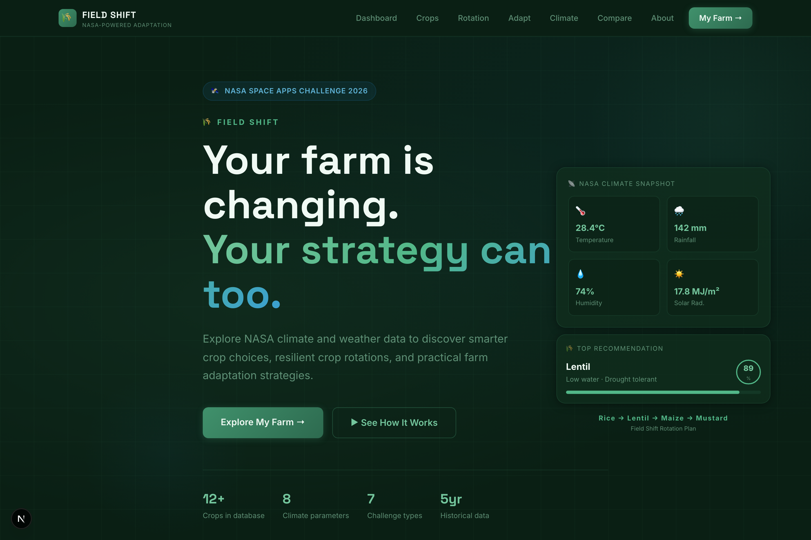
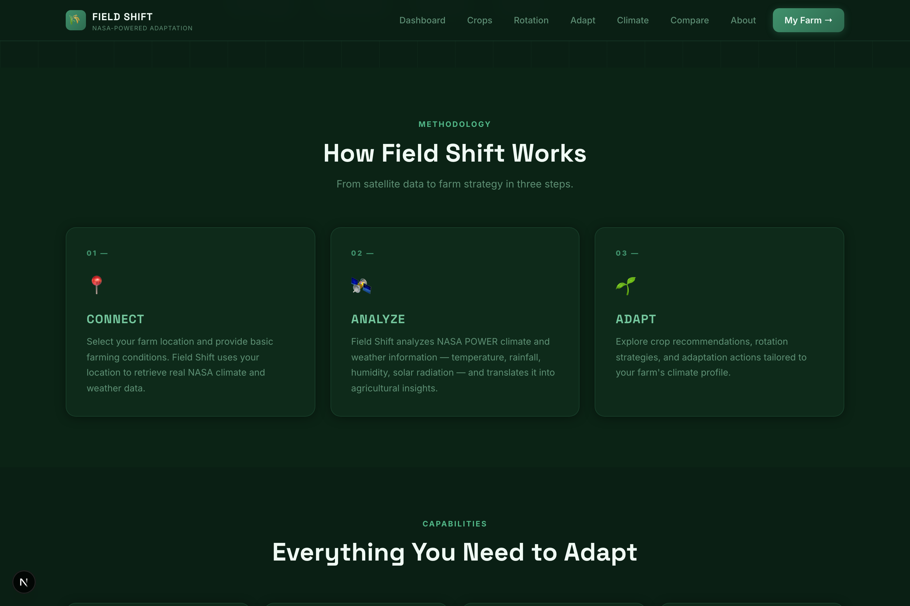
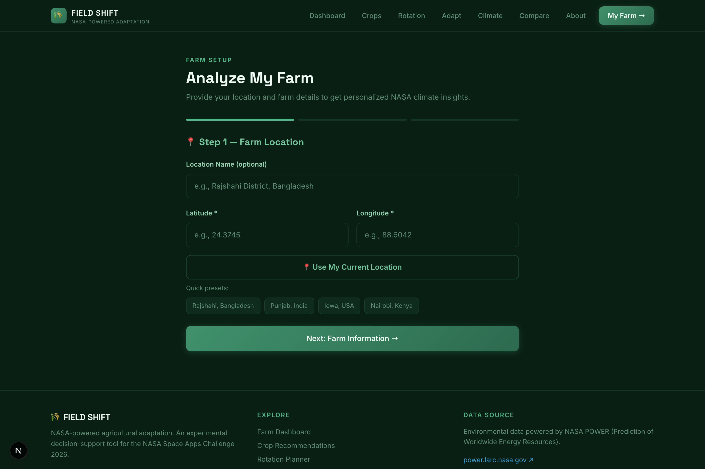
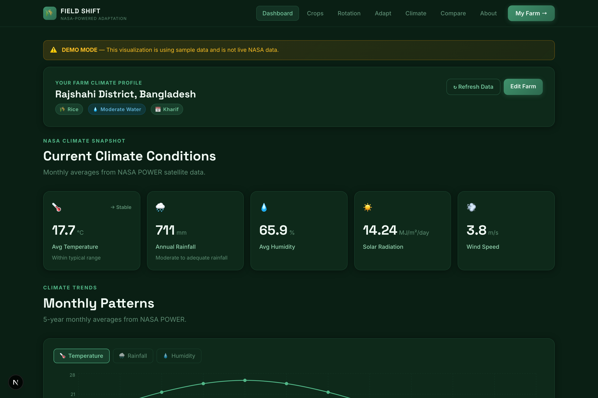
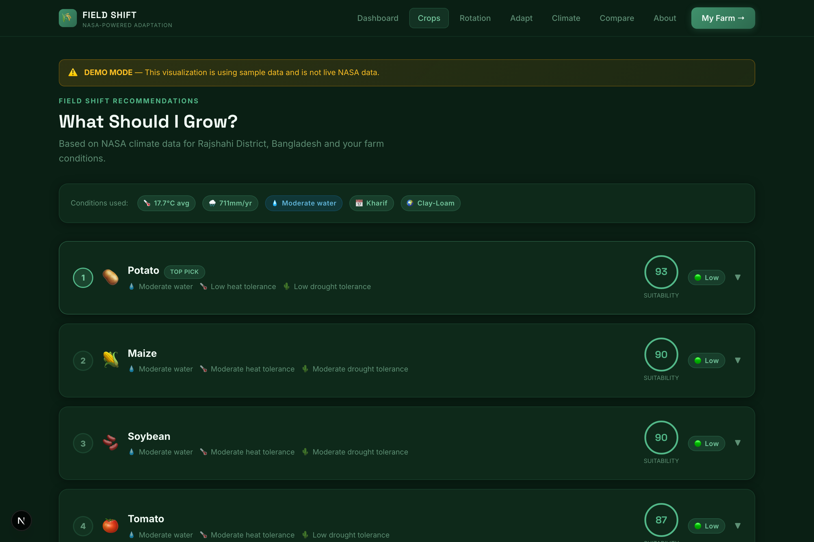
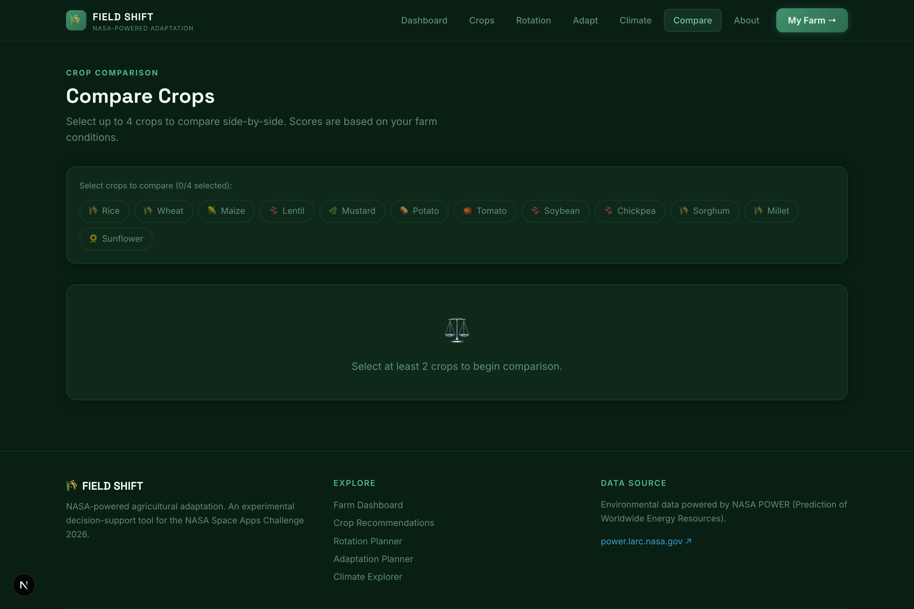
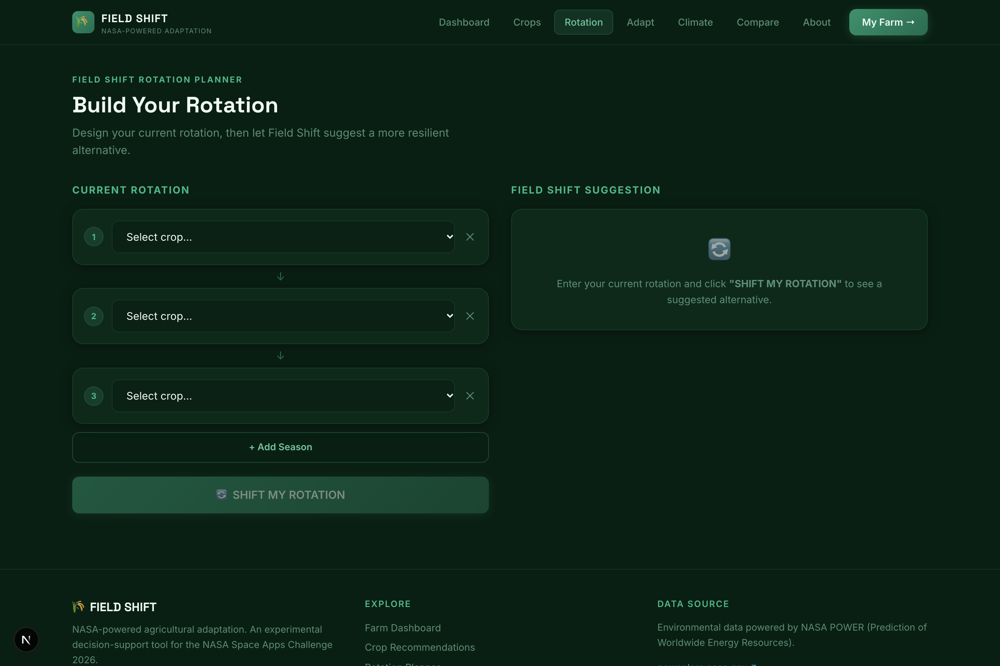
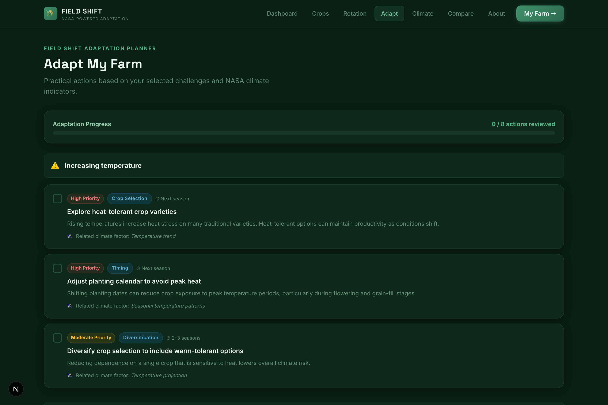
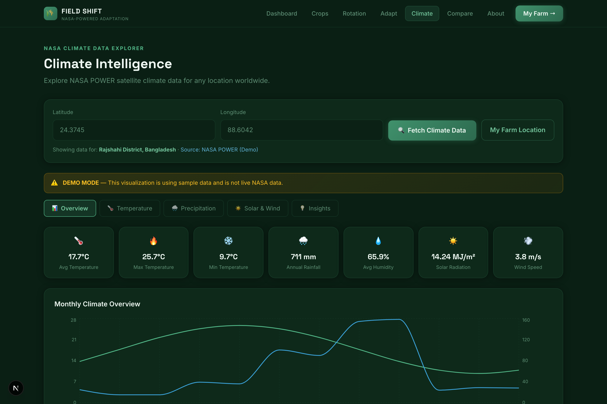
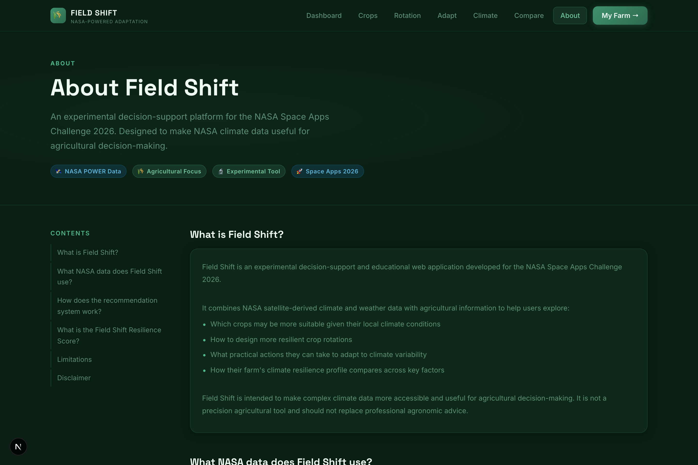

# 🌾 FIELD SHIFT
> **“Your farm is changing. Your strategy can too.”**
>
> *Agricultural Decision-Support Platform Powered by NASA Earth Science Data*  
> **Built for the NASA Space Apps Challenge 2026**

---

## 📌 Executive Summary

Climate variability is placing unprecedented pressure on global agriculture. Smallholder farmers and agricultural planners face shifting growing windows, erratic rainfall, depleting water tables, and extreme heat waves. Although NASA satellites collect terabytes of Earth observation data daily, this planetary intelligence remains largely inaccessible to grassroots growers due to complex scientific formats and academic interfaces.

**Field Shift** transforms raw NASA Earth observation metrics into intuitive, localized, and actionable agricultural intelligence. It empowers growers, agronomists, and rural planners to evaluate localized environmental shifts, discover climate-resilient crops, construct restorative crop rotations, and execute prioritized farm adaptation plans.

Field Shift is **not merely a visualization dashboard** — it is an end-to-end agronomic decision companion that bridges satellite telemetry with practical, field-level action.

---

## 📸 Product Tour & Sequential Walkthrough

Explore Field Shift's user journey step-by-step, from onboarding to deep climate analysis and seasonal planning:

### 1. Welcome & Overview (`/`)
The landing experience introduces growers to Field Shift's three-step philosophy: **Connect** (localized positioning), **Analyze** (NASA satellite telemetry), and **Adapt** (agronomic strategies).



---

### 2. Core Pillars & Value Proposition (`/`)
An interactive breakdown of the six core decision tools available within the platform, highlighting transparent methodology, data sourcing, and farmer-centric workflows.



---

### 3. Farm Profile Configuration & Geolocation (`/dashboard/setup`)
A guided setup flow that captures the farm's location (via GPS geolocation, manual coordinates, or regional presets), current staple crop, soil classification, water access level, irrigation infrastructure, and active climate challenges.



---

### 4. Farm Climate Dashboard & Resilience Score (`/dashboard`)
The central command center synthesizes NASA POWER meteorological data into a holistic **Farm Resilience Score (0–100)**, actionable plain-language climate takeaways, seasonal temperature and rainfall charts, and immediate risk warnings.



---

### 5. Crop Recommendation Engine (`/crop-recommendation`)
A multi-factor suitability engine that ranks curated crops against local climate normals. Each crop card provides a qualitative rating (*Excellent, Good, Moderate, Fair, Low*), a detailed factor breakdown, water requirements, and risk factors.



---

### 6. Side-by-Side Crop Comparison Matrix (`/compare`)
Enables growers to benchmark up to 4 crops simultaneously across critical climate-resilience attributes: thermal thresholds, drought resistance, flood tolerance, growth cycles, and water intensity.



---

### 7. Regenerative Crop Rotation Planner (`/rotation-planner`)
Compares the farmer's current monoculture sequence with a climate-optimized 3-season rotation. Integrates nitrogen-fixing legumes, alternating root depths, and pest-break crops to rebuild soil health and lower water vulnerability.



---

### 8. Prioritized Farm Adaptation Roadmap (`/adaptation-planner`)
Translates identified risks (e.g., rising temperatures, delayed monsoons, groundwater depletion) into a phased roadmap across three execution horizons: **Immediate**, **Pre-Season**, and **Long-Term**.



---

### 9. Interactive Climate Data Explorer (`/climate`)
Deep-dive into multi-year NASA POWER climatological monthly patterns. Switch between high-resolution charts for monthly temperatures, precipitation curves, solar radiation, and wind speeds.



---

### 10. Scientific Transparency & Methodology (`/about`)
Complete transparency into NASA data endpoints, mathematical scoring formulas, parameter weighting, system limitations, and decision-support boundaries.



---

## 🛰️ NASA Earth Science Data Integration

Field Shift directly integrates with the **NASA POWER** (*Prediction Of Worldwide Energy Resources*) API, hosted by the NASA Langley Research Center. The platform leverages solar and meteorological datasets derived from NASA satellite observations and assimilation models (including CERES and MERRA-2):

| NASA Parameter | Full Name | Agricultural Application in Field Shift |
|---|---|---|
| `T2M` | Temperature at 2 Meters (°C) | Optimal growing degree day & thermal suitability scoring |
| `T2M_MAX` / `T2M_MIN` | Daily Maximum / Minimum Temperature (°C) | Heat stress risk thresholds & frost window identification |
| `PRECTOTCORR` | Precipitation Corrected (mm/day) | Monthly & seasonal water availability vs. crop water requirements |
| `RH2M` | Relative Humidity at 2 Meters (%) | Fungal/pest pressure risk factor & evapotranspiration modeling |
| `ALLSKY_SFC_SW_DWN` | All-Sky Surface Shortwave Downward Irradiance (MJ/m²/day) | Photosynthetic solar radiation & biomass accumulation potential |
| `WS2M` | Wind Speed at 2 Meters (m/s) | Mechanical crop stress & evapotranspiration acceleration |
| `T2MDEW` | Dew/Frost Point Temperature (°C) | Nighttime condensation & frost event hazard forecasting |

### Data Reliability & Zero-Downtime Architecture
- **5-Year Climatological Normals**: Calculates multi-year monthly averages to capture long-term climate trajectories rather than transient daily weather fluctuations.
- **Dual-Layer Caching**: High-performance MongoDB cache prevents redundant NASA API queries, paired with an automatic in-memory fallback.
- **Calibrated Fallback Demo Datasets**: If NASA API rate limits or network disconnections occur, Field Shift gracefully transitions to regionally calibrated demo data with transparent visual indicators.

---

## 🧮 Algorithmic Scoring Framework

Field Shift prioritizes **explainable, transparent intelligence** over opaque black-box recommendations.

### 1. Multi-Factor Crop Suitability Algorithm (0–100)
Every crop in the catalog is evaluated against six localized environmental factors:

$$\text{Suitability Score} = \sum (\text{Factor Score}_i \times \text{Weight}_i)$$

* **Temperature Match (25%)**: Evaluates deviation between local average temperatures and crop-specific optimal thermal envelopes $[T_{\min}, T_{\text{optimal}}, T_{\max}]$.
* **Rainfall Match (25%)**: Compares annual/seasonal precipitation against cumulative crop water requirements.
* **Water Access Security (20%)**: Reconciles farm water supply (irrigation, groundwater access) with crop water intensity (*Very Low* to *Very High*).
* **Growing Season Alignment (15%)**: Validates whether the active farming window (*Kharif, Rabi, Pre-Kharif, Boro, Year-Round*) matches the crop's physiological cycle.
* **Soil Compatibility (10%)**: Checks compatibility between the local soil classification (e.g., *Clay, Loam, Sandy-Loam, Clay-Loam*) and root development preferences.
* **Climate Stress Bonus (5%)**: Awards bonus tolerance points when crops possess genetic resilience against farmer-identified threats (e.g., extreme heat tolerance during hot spells).

Qualitative Classifications:
* **85–100**: *Excellent* — Optimal climate alignment with minimal external inputs.
* **70–84**: *Good* — Favorable conditions with minor management adjustments.
* **55–69**: *Moderate* — Viable, but may encounter seasonal climatic stress.
* **40–54**: *Fair* — Suboptimal; requires targeted irrigation or soil management.
* **0–39**: *Low* — Severe climatic mismatch; high risk of crop failure.

### 2. Farm Resilience Index (0–100)
A holistic scorecard evaluating total farm security across five foundational pillars:
1. **Climate Alignment (0–25 pts)**: Suitability score of the primary staple crop.
2. **Water Security (0–20 pts)**: Equilibrium between water sources, irrigation, and crop demand.
3. **Crop Diversification (0–20 pts)**: Multi-crop species variety in active rotation.
4. **Climate Risk Awareness (0–20 pts)**: Identification of active environmental hazards.
5. **Adaptation Readiness (0–15 pts)**: Deployment of protective infrastructure (e.g., drip irrigation, mulching).

---

## 🛠️ Tech Stack & System Architecture

```
┌─────────────────────────────────────────────────────────────┐
│                      Client Layer                           │
│  Next.js 16 (App Router) • React 19 • Tailwind CSS v4       │
│  Lucide Icons • Recharts (Responsive Data Visualizations)   │
└──────────────┬──────────────────────────────┬───────────────┘
               │                              │
               ▼                              ▼
┌──────────────────────────────┐ ┌────────────────────────────┐
│      Next.js Route APIs      │ │       State Management     │
│  /api/climate                │ │  React Context (FarmContext│
│  /api/recommendations        │ │  + LocalStorage Hydration) │
│  /api/rotation               │ └────────────────────────────┘
│  /api/adaptation             │
│  /api/crops & /api/farm      │
└──────────────┬───────────────┘
               │
       ┌───────┴───────┐
       ▼               ▼
┌──────────────┐ ┌────────────────────────────────────────────┐
│ NASA POWER   │ │             Database & Caching             │
│ API Engine   │ │  MongoDB Atlas (Mongoose ODM)              │
│ (CERES/MERRA)│ │  + Seamless Zero-Config In-Memory Fallback │
└──────────────┘ └────────────────────────────────────────────┘
```

* **Framework**: [Next.js](https://nextjs.org/) (App Router, React Server & Client Components, Turbopack)
* **Frontend**: React 19, Tailwind CSS v4, custom glassmorphism design system
* **Visualizations**: [Recharts](https://recharts.org/) for responsive meteorological time-series graphs
* **Database**: [MongoDB](https://www.mongodb.com/) via Mongoose ODM (with automatic fallback to in-memory store for zero-dependency standalone execution)
* **External APIs**: NASA POWER API (NASA Langley Research Center)

---

## 📁 Repository File Structure

```bash
field-shift/
├── public/
│   └── screenshots/              # High-resolution sequential walkthrough captures
│       ├── 01-landing-page.png
│       ├── 02-landing-features.png
│       ├── 03-farm-setup.png
│       ├── 04-farm-dashboard.png
│       ├── 05-crop-recommendations.png
│       ├── 06-crop-comparison.png
│       ├── 07-rotation-planner.png
│       ├── 08-adaptation-planner.png
│       ├── 09-climate-explorer.png
│       └── 10-about-methodology.png
├── scripts/
│   └── capture-all.mjs           # Automated Chrome Headless CDP screenshot pipeline
├── src/
│   ├── app/                      # Next.js App Router pages & API routes
│   │   ├── page.js               # Landing page
│   │   ├── dashboard/            # Farm climate dashboard & setup wizard
│   │   ├── crop-recommendation/  # Crop recommendation engine
│   │   ├── compare/              # Side-by-side crop comparison matrix
│   │   ├── rotation-planner/     # Regenerative crop rotation planner
│   │   ├── adaptation-planner/   # Farm adaptation action roadmap
│   │   ├── climate/              # Interactive climate explorer
│   │   ├── about/                # Scientific methodology & documentation
│   │   └── api/                  # Edge & Node API route handlers
│   ├── components/
│   │   └── ui/                   # Modular UI components (Navbar, Footer, Cards, Badges)
│   ├── context/
│   │   └── FarmContext.jsx       # Global reactive farm state & local persistence
│   ├── data/
│   │   └── crops.js              # Curated agronomic database (20+ crops with thermal/water limits)
│   ├── lib/
│   │   ├── nasa.js               # NASA POWER API fetcher, normalizer & demo generator
│   │   ├── climate.js            # Plain-language meteorological insight generation
│   │   ├── recommendation.js     # Suitability scoring & resilience algorithms
│   │   └── mongodb.js            # MongoDB connection client with memory fallback
│   └── models/                   # Mongoose schemas (Farm, Crop, ClimateData)
└── package.json
```

---

## 🚀 Getting Started

### Prerequisites
* **Node.js**: v18.17.0 or higher (v20+ recommended)
* **Package Manager**: npm, yarn, or pnpm

### Installation

1. **Clone the repository:**
   ```bash
   git clone https://github.com/your-username/field-shift.git
   cd field-shift
   ```

2. **Install project dependencies:**
   ```bash
   npm install
   ```

3. **Configure Environment Variables (Optional):**
   Copy the example environment file:
   ```bash
   cp .env.local.example .env.local
   ```
   *Note: `MONGODB_URI` is completely optional. If omitted, Field Shift runs seamlessly using an automatic in-memory cache.*

4. **Start the local development server:**
   ```bash
   npm run dev
   ```

5. **Open in your browser:**
   Navigate to [http://localhost:3000](http://localhost:3000) to explore Field Shift.

---

## 🔌 API Endpoints Reference

| Endpoint | Method | Description |
|---|---|---|
| `/api/climate` | `GET` | Fetches and processes NASA POWER climate data for given coordinates (`?lat=...&lon=...`) |
| `/api/recommendations` | `POST` | Computes crop suitability rankings and factor breakdowns for farm conditions |
| `/api/rotation` | `POST` | Generates 3-season restorative crop rotations based on current crop and soil |
| `/api/adaptation` | `POST` | Builds chronological adaptation roadmaps targeted at user-specified challenges |
| `/api/crops` | `GET` | Returns the comprehensive agronomic crop catalog and parameters |
| `/api/farm` | `GET` / `POST` | Manages farm profile persistence and storage |

---

## 🔮 Future Roadmap & Vision

* **NASA SMAP & ECOSTRESS Integration**: Ingest real-time root-zone soil moisture from SMAP and thermal evapotranspiration from ECOSTRESS to monitor crop water stress before visual symptoms appear.
* **Surface Reflectance & NDVI**: Connect Sentinel-2 and Landsat surface reflectance to provide field-level vegetation index time series.
* **Cultivar-Level Granularity**: Expand species-level databases to localized hybrid varieties and drought-tolerant open-pollinated seed varieties.
* **Economic & Market Intelligence**: Blend climate suitability scores with real-time wholesale agricultural commodity price trends.
* **Low-Bandwidth SMS / USSD Advisory**: Deploy a lightweight SMS/audio advisory system to deliver critical planting recommendations to smallholders in regions with limited smartphone penetration.

---

## 📜 Scientific & Decision-Support Notice

> **Disclaimer**: *Field Shift Suitability Scores and climate recommendations are informational decision-support tools derived from satellite observations and meteorological models. Local soil chemistry, microclimates, regional extension guidelines, and farmer expertise must always be consulted prior to making financial or planting commitments.*

---

## 🏆 NASA Space Apps Challenge 2026
Built with ❤️ for growers, agronomists, and the global Earth science community.
